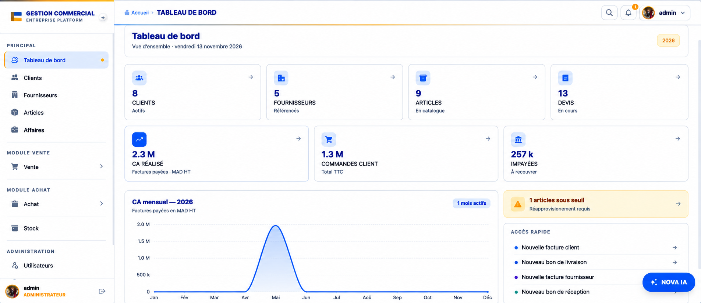
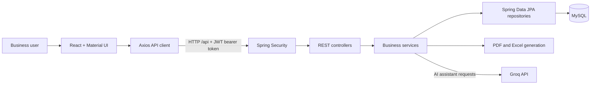
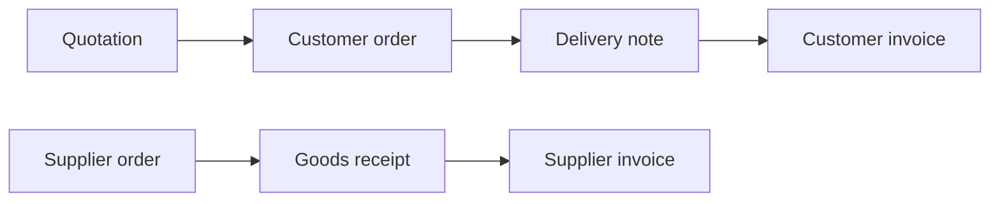

# Gestion Commercial

**A full-stack business management application built with React, Spring Boot and MySQL.**

Manage customers, suppliers, sales, purchasing and inventory from a single workspace, with a dashboard and an integrated AI assistant.

## Dashboard preview



The dashboard brings together customer and supplier counts, catalog size, quotations, paid invoice revenue, customer order totals and outstanding receivables. A monthly revenue chart, low-stock alerts and shortcuts help users move from monitoring activity to everyday operations. Amounts are displayed in Moroccan dirhams (MAD).

## Explore the project

[Features](#features) ? [Technology](#technology) ? [Architecture](#architecture) ? [Business workflows](#business-workflows) ? [Local setup](#run-locally) ? [Project structure](#project-structure)

## Features

- **Sales workflow:** quotations, customer orders, delivery notes and customer invoices.
- **Purchasing workflow:** supplier orders, goods receipts and supplier invoices.
- **Inventory:** product catalog, stock monitoring and stock movements.
- **Business records:** customers, suppliers and business affairs.
- **Administration:** users, roles, company settings and personal profiles.
- **Reporting:** dashboard charts, PDF generation and Excel export capabilities.
- **AI assistant:** Nova, powered by Groq, available through the application chat widget.
- **Authentication:** Spring Security with JWT access and refresh tokens.

The application interface is in French.

## Technology

| Layer | Technologies |
| --- | --- |
| Frontend | React 18, Vite 5, Material UI, Recharts, Axios |
| Backend | Java 21, Spring Boot 3.4, Spring Security, Spring Data JPA |
| Database | MySQL |
| Documents | iText 7, Apache POI, SheetJS |
| API documentation | Springdoc OpenAPI / Swagger UI |
| AI integration | Groq API |

## Architecture

The application uses a React client and a layered Spring Boot API. The frontend sends HTTP requests through a shared Axios client, while the backend handles authentication, business rules and persistence.



| Component | Responsibility |
| --- | --- |
| React pages and shared components | Business screens, navigation, forms, dashboard and chat widget |
| Authentication context and private routes | Client session state and protected navigation |
| Shared Axios client | API requests, bearer token headers and handling expired sessions |
| Controllers and DTOs | HTTP endpoints and request/response data |
| Spring Security | Authentication and access control |
| Services | Business operations and integrations |
| Repositories and entities | Database access and relational domain model |
| Configuration and exception handling | Application setup and backend error handling |

During development, Vite runs on port **5173** and proxies `/api` to Spring Boot on port **8080**. The backend connects to MySQL on port **3306**. The Groq integration runs on the backend so its API key can stay out of the browser.

## Business workflows

The sales and purchasing modules organize related documents around these business sequences:



These sequences describe the document lifecycle; they do not imply that every step is converted automatically. Product records and stock movements support inventory tracking, while payment management supports invoice follow-up.

## Run locally

### Requirements

- Java 21 and Maven
- Node.js and npm
- A running MySQL server
- A Groq API key for the AI assistant

### Backend

Create a MySQL database named `gestion_commercial`. Configure the connection through environment variables rather than committing personal credentials:

```powershell
$env:SPRING_DATASOURCE_URL = 'jdbc:mysql://localhost:3306/gestion_commercial?useSSL=false&serverTimezone=UTC&allowPublicKeyRetrieval=true&characterEncoding=UTF-8'
$env:SPRING_DATASOURCE_USERNAME = 'your_mysql_user'
$env:SPRING_DATASOURCE_PASSWORD = 'your_mysql_password'
$env:APP_JWT_SECRET = 'replace-with-a-long-random-secret-at-least-32-characters'
$env:GROQ_API_KEY = 'your_groq_api_key'
cd backend
mvn spring-boot:run
```

Spring Data JPA updates the database schema on startup. The API runs at `http://localhost:8080`.

On Windows, you can also copy `.env.cmd.example` to `.env.cmd`, fill in your local settings and use `run-backend.cmd`.

### Frontend

Open a second terminal:

```bash
cd frontend
npm ci
npm run dev
```

Open **http://localhost:5173**. Vite proxies `/api` requests to the backend on port 8080.

To create a production frontend build:

```bash
npm run build
```

## Project structure

```text
backend/                  Spring Boot API and business logic
  src/main/java/com/gestion/commerciale/
    config/               Application configuration
    controller/           REST endpoints
    dto/                  Request and response objects
    entity/               Persistence entities
    exception/            Error handling
    repository/           Spring Data JPA repositories
    security/             Authentication and authorization
    service/              Business logic and integrations
  src/main/resources/     Application configuration
frontend/                 React application
  src/components/         Shared layout, chat and payment components
  src/context/            Authentication state
  src/pages/              Business screens organized by module
  src/services/           API clients
docs/screenshots/         Application screenshots used in this README
run-backend.cmd           Windows backend launcher
```

## Author

Built by [Ibtihal](https://github.com/ibtihalch).
